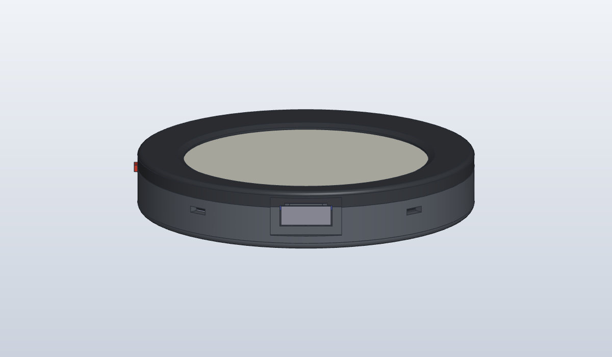
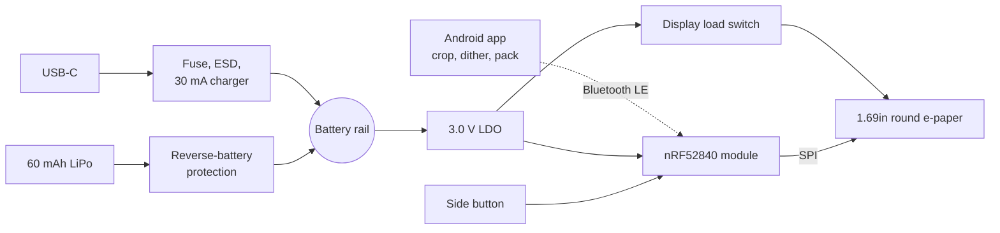
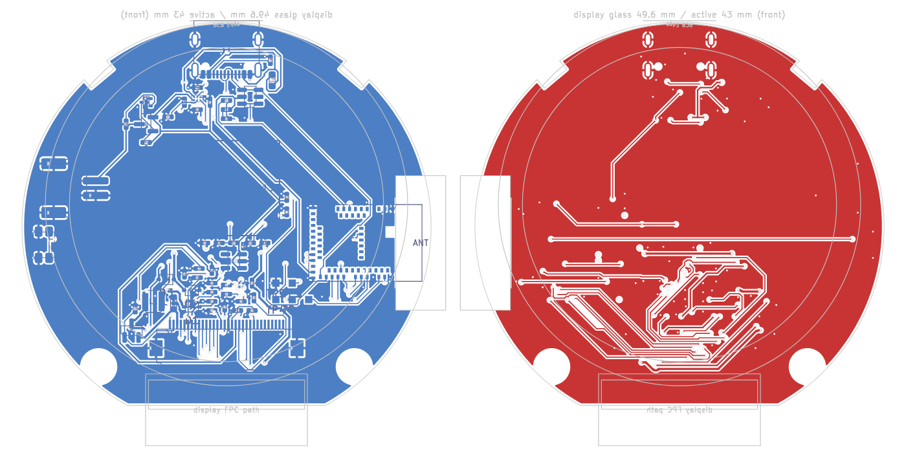
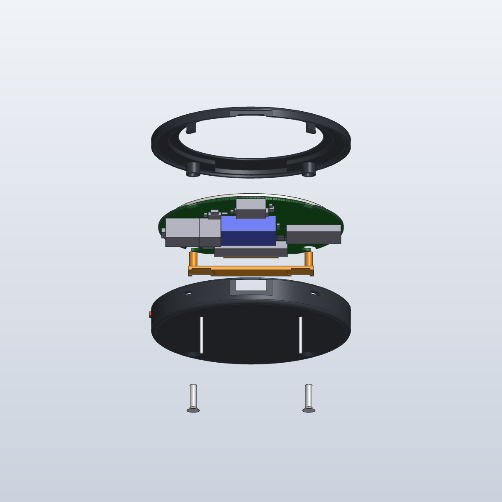
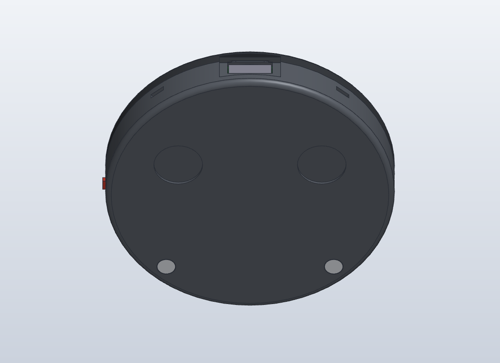

# Open E-Pin

An open-source, battery-powered e-ink pin you can wear on a jacket or bag. It has a round
1.69" colour e-paper display, Bluetooth Low Energy and a small rechargeable battery. You pick
a photo in the Android app, place it in the circle, and the app converts it to the panel's six
colours and sends it to the pin. E-paper keeps the picture with no power at all, so the pin
sleeps until you press its button.

> **Status: v0.1, work in progress.** The board is designed and fully routed, the case is
> modelled and fit-checked against every part, and the firmware and app frameworks build and
> pass their unit tests. Nothing has been built or run on real hardware yet, so please don't
> order boards from this revision.

## Features

- **Round colour e-paper:** Good Display GDEH0169E02, 1.69", 400 x 400 pixels, six colours
  (Spectra 6). The image stays on screen with the power off.
- **Bluetooth Low Energy:** Nordic nRF52840 in a pre-certified Raytac MDBT50Q-1MV2 module.
- **Tiny sleep current:** the pin sleeps in System OFF (about 0.6 uA estimated, including the
  battery monitor) and only wakes on a button press. The display supply is switched off between refreshes.
- **Small rechargeable battery:** 3.7 V 60 mAh LiPo on a JST-PH connector, so it can be
  unplugged or swapped.
- **Safe charging over USB-C:** TI BQ25101 charger at 30 mA, with a thermistor against the cell
  so it only charges between 0 °C and 60 °C.
- **Protected inputs:** reverse-battery protection, plus a resettable fuse, ESD array and
  overvoltage cutoff on USB.
- **Resumable uploads:** if the Bluetooth link drops mid-transfer, the app picks up where it
  stopped. Each image is checked with a CRC before it's drawn.
- **Printed case** with a clean front, screws from the back and two locking pin-back posts.
- **Fully open:** KiCad schematic and board, case model, firmware and app, plus the scripts
  that generate the hardware files.

## Specifications

| | |
|---|---|
| Display | Good Display GDEH0169E02, 1.69" round, 400 x 400, Spectra 6, 32-pin 0.5 mm FPC |
| MCU / radio | Raytac MDBT50Q-1MV2 (nRF52840, Bluetooth 5, chip antenna) |
| Battery | 3.7 V LiPo, 60 mAh, JST-PH 2.0 mm, cell has its own protection circuit |
| Charging | USB-C, 30 mA, temperature-qualified (BQ25101) |
| Power | 3.0 V LDO (TPS7A0230), switched display rail (TPS22916C) |
| Controls | One side-press button, charge LED |
| Board | 56 mm round with a flat for the display ribbon, 4 layers, all parts on the back |
| Case | 3D-printed bezel and back cover, 60.4 mm across, 10.75 mm thick |
| Firmware | Zephyr / nRF Connect SDK, flashed over SWD test pads |
| App | Android 8.0 (API 26) or newer, Kotlin and Jetpack Compose |

## How it works

1. Press the button. The pin wakes and advertises as `Open E-Pin` for 60 seconds.
2. In the app, pick a photo, drag and pinch it into the circle, and adjust it. The app dithers
   it to the six ink colours and packs it two pixels per byte.
3. The app connects and uploads the image. The pin checks it, switches the display on, draws
   it, switches the display off again and goes back to sleep.

The Bluetooth protocol shared by the app and firmware is in
[`docs/ble-protocol.md`](docs/ble-protocol.md).

## Hardware

The board is a 56 mm round, 4-layer PCB with every part on the back and the display on the
front. The schematic and board are generated from one Python file,
[`hardware/scripts/design.py`](hardware/scripts/design.py), which lists every part and
connection, and the board is autorouted by a script. See the
[hardware README](hardware/README.md) for the block diagram, pin map, safety notes,
regeneration and routing steps, and the open items to check before ordering boards. The parts
list is in [`hardware/bom/open-e-pin-bom.csv`](hardware/bom/open-e-pin-bom.csv), and there is
a [PDF of the schematic](hardware/docs/schematic.pdf) if you don't have KiCad.

## Case

| Exploded view | Back |
|---|---|
|  |  |

A two-part printed case: a **bezel** with the display window, and a **back cover**. Two M2
countersunk screws go in from the back into brass heat-set inserts in the bezel, so the front
is just the ring and the display, and two snap hooks hold the top. Two locking pin-back posts,
glued into pockets on the back, stop the pin from spinning on a bag. A small printed plunger
works the side button.

The [SolidCraft](hardware/case/solidcraft/) design is the master for the case; the printable
STEP and STL files in [`hardware/case/out/`](hardware/case/out/) are exported from it. The
[case README](hardware/case/README.md) has the fastener list, fit-check measurements,
assembly steps and the assumptions to check on real parts.

## Firmware

Zephyr-based firmware for the nRF52840 in [`firmware/`](firmware/). It sleeps in System OFF,
wakes on the button, advertises, receives an image over a custom GATT service, checks its
CRC-32 and draws it on the panel. It also reports battery level through the standard Battery
Service. It builds for the pin board (`open_e_pin/nrf52840`) and for an nRF52840 DK for bench
work, and the transfer logic has unit tests that run on a PC.

The panel driver follows Good Display's sample code for this panel but hasn't been run on
a real panel yet. See the [firmware README](firmware/README.md) for building, flashing, logs over
RTT, and the checklist before powering a real panel.

## Android app

A Kotlin app in [`app/`](app/) that finds the pin, lets you pick an image with the system photo
picker and place it in the round frame, then adjusts, dithers and uploads it. All the image
and protocol logic lives in a plain-Kotlin `core` module with unit tests, and the `android`
module holds the Jetpack Compose UI and BLE code. The UI hasn't been run on a phone yet. See
the [app README](app/README.md) for the image pipeline, building and permissions.

## Repository layout

| Path | What it is |
|---|---|
| [`hardware/`](hardware/) | Main board: KiCad 7 project, generator and routing scripts, BOM, docs |
| [`hardware/case/`](hardware/case/) | Printed case: SolidCraft master, STEP/STL exports, fit check |
| [`firmware/`](firmware/) | nRF52840 firmware (Zephyr / nRF Connect SDK) |
| [`app/`](app/) | Android companion app (Kotlin, Jetpack Compose) |
| [`docs/ble-protocol.md`](docs/ble-protocol.md) | Bluetooth protocol between the app and the pin |
| [`GDEH0169E02.pdf`](GDEH0169E02.pdf) | Display specification from Good Display, kept for reference |

## Roadmap

- [x] Schematic and part selection
- [x] Board placement and routing
- [x] Printed case, fit-checked against the board, battery and display
- [x] Firmware framework: sleep and wake, BLE image transfer with resume, battery reporting
- [x] App framework: image pipeline, dithering, resumable uploader
- [ ] Check the [open items](hardware/README.md) on real parts (display ribbon fold, battery
      thickness, footprints) and order the first boards
- [ ] Port the real panel init sequence and test on a panel
- [ ] Run the app on a phone against the firmware
- [ ] Print and assemble a case
- [ ] Bonding so only a paired phone can send images, and over-the-air firmware updates

## Contributing

Issues and pull requests are welcome, especially reviews of the schematic and case before the
first boards are ordered. A few conventions keep things in sync:

- **Board:** edit `hardware/scripts/design.py` and regenerate rather than editing the KiCad
  files by hand.
- **Case:** edit the SolidCraft design and re-export to `hardware/case/out/`.
- **Protocol:** change [`docs/ble-protocol.md`](docs/ble-protocol.md) first, then the firmware
  and app together.

## License

GPL-3.0. See [LICENSE](LICENSE).

The display specification (`GDEH0169E02.pdf`) is © Good Display and is included only for
reference. It is not covered by this project's license.
