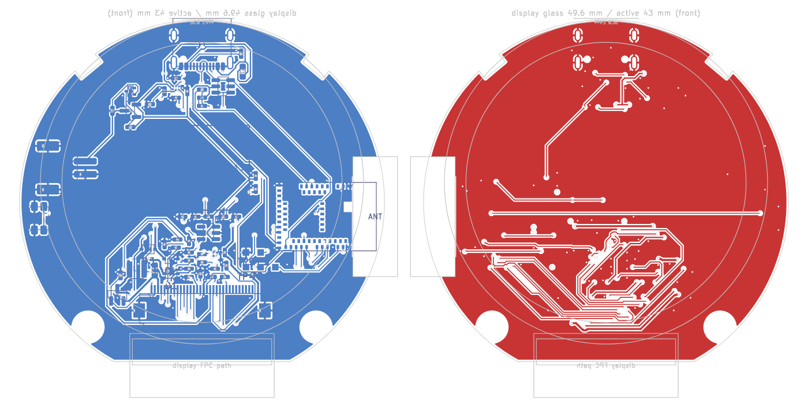
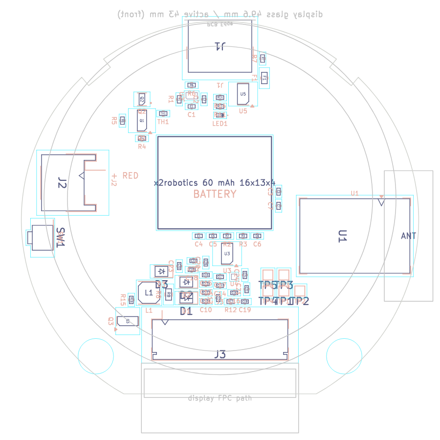
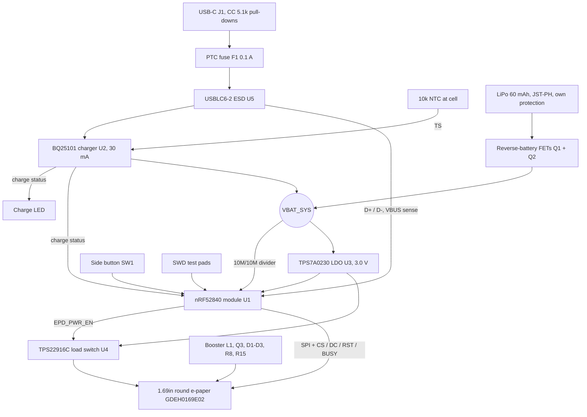

# Open E-Pin hardware

KiCad 7 project for the main board. The schematic and board are **generated** from
[`scripts/design.py`](scripts/design.py), which lists every part and every connection.
Change the design there, then regenerate, so the schematic and board never drift apart.





## Files

| Path | What it is |
|---|---|
| `kicad/open-e-pin.kicad_sch` | Schematic (one sheet, every pin labelled with its net) |
| `kicad/open-e-pin.kicad_pcb` | Board: 56 mm round with a flat for the display ribbon, 2 case-screw holes (4.6 mm, unplated, for the bezel's insert bosses), 2 notches for the case's snap hooks, 4 layers, placed and routed |
| `kicad/open-e-pin.kicad_sym` | Custom symbols (BQ25101, TPS7A0230, TPS22916C, GDEH0169E02 FPC) |
| `kicad/OpenEPin.pretty` | Custom footprints for TI's YFP packages (BQ25101, TPS22916C), written by `scripts/gen_footprints.py` |
| `case/` | Printed case, fit check and fastener list, see [case/README.md](case/README.md) |
| `bom/open-e-pin-bom.csv` | Bill of materials |
| `docs/schematic.pdf` | Schematic as a PDF |
| `docs/placement-back.png`, `docs/placement.csv` | Part placement view and coordinates |
| `docs/routing.png` | Back and front copper |
| `scripts/` | `design.py` (parts and nets), `gen_footprints.py`, `gen_schematic.py`, `gen_board.py`, `route.py`, `gen_bom.py`, `export_envelope.py` (part sizes for the case) |

## Regenerating

Needs KiCad 7 and its Python module (`pcbnew`). On Linux the system `python3` has it; on
Windows use the Python that ships with KiCad (`C:\Program Files\KiCad\7.0\bin\python.exe`)
and set `KICAD7_SYMBOL_DIR` and `KICAD7_FOOTPRINT_DIR` to KiCad's `share\kicad\symbols` and
`share\kicad\footprints` folders.

```
cd hardware/scripts
python3 design.py          # checks parts and nets
python3 gen_footprints.py  # writes kicad/OpenEPin.pretty
python3 gen_schematic.py   # writes kicad/open-e-pin.kicad_sch and the symbol library
python3 gen_board.py       # writes kicad/open-e-pin.kicad_pcb (overwrites placement!)
python3 gen_bom.py         # writes bom/open-e-pin-bom.csv
```

### Routing

`gen_board.py` writes an unrouted board, so routing is redone after it. Needs Java 17 or later
and [Freerouting 1.9.0](https://github.com/freerouting/freerouting/releases/tag/v1.9.0)
(2.x ignores its pass limit when run from the command line and never saves).

```
python3 route.py prep      # rules, net classes, planes, GND/3V0 via fan-out; writes build/open-e-pin.dsn
java -jar freerouting-1.9.0.jar -de ../build/open-e-pin.dsn -do ../build/open-e-pin.ses -mp 100
python3 route.py import ../build/open-e-pin.ses
```

On a Linux machine with no screen, put `xvfb-run -a` in front of the `java` command.
`import` loads the autorouted tracks, fans out any GND/3V0 pad the autorouter boxed in
(ripping up the signal tracks round it if it has to),
rips up and re-routes any net that is still open or breaks clearance (a small maze router in
`route.py`), then adds GND pours on both outer layers and stitches them to the GND plane.

Stackup: B.Cu parts and signals, In1.Cu solid GND, In2.Cu 3V0 plane, F.Cu signals and GND
pour under the display. Rules: 0.15 mm tracks and clearance, 0.2 mm for power (narrow enough
to leave the 0.4 mm-pitch TI WCSP balls), 0.3 mm for the display booster, 0.2 mm tracks with 0.2 mm spacing for the panel's +/-20 V rails, 0.5/0.25 mm vias.
The antenna keep-out is clear of copper on every layer.

Once you start editing the routing by hand in KiCad, stop running `gen_board.py` and
`route.py` on it, and use **Tools > Update PCB from Schematic** instead.

## Block diagram



## Safety features

- Charge current set to 30 mA (0.5C for a 60 mAh cell) by R1. Use 5.6k (about 24 mA) for cells rated below 30 mA.
- The charger pauses below 0 °C and stops above 60 °C, using an NTC placed against the cell.
- The charger input survives 30 V and stops charging above about 6.7 V. A 0.1 A resettable fuse and an ESD array protect the USB port.
- Reverse-battery protection (Q1, Q2) blocks a backwards cell, including when USB is plugged in.
- The cell's own protection circuit covers over-discharge, overcharge and short circuit.

## MCU pin map

| Signal | nRF52840 | Module pin |
|---|---|---|
| EPD_SCK / EPD_MOSI | P0.22 / P0.24 | 46 / 48 |
| EPD_CS / EPD_DC | P0.20 / P0.17 | 44 / 41 |
| EPD_RST / EPD_BUSY | P0.15 / P0.13 | 39 / 37 |
| EPD_PWR_EN | P1.00 | 47 |
| VBAT_SENSE (AIN5) | P0.29 | 10 |
| CHG_SENSE | P0.31 | 12 |
| BUTTON (active low) | P1.06 | 57 |
| USB D+ / D- | USB | 35 / 34 |
| SWDIO / SWDCLK / RESET | SWD, P0.18 | 51 / 53 / 40 |

## Open items before ordering boards

1. **Display wiring (done, check on first build):** all 32 pins of the GDEH0169E02 (IST7163 controller) are wired to the reference circuit in figures 7-1 and 7-2 of its specification. Panel VDD (pin 15) runs from the switched 3.0 V rail (spec range 2.4 to 3.6 V). Ten rail pins (1, 4, 5, 6, 16, 18, 19, 20, 22, 24) each get a 1 uF cap to GND, with 35 V on VSL3 (pin 19). Pins 7 and 25 to 32 are left open as the reference shows. The booster is L1 47 uH, Q3 N-FET with a 10k gate pull-down (R15), R8 0.47 ohm sense, D1 to D3 Schottky diodes and C24 as the charge-pump cap; it makes VGH (pin 21) and VGL (pin 23). BS0 is pulled low for 4-wire SPI.
2. **TI WCSP footprints (done):** BQ25101 (YFP0006) and TPS22916C (YFP0004) now use footprints drawn from TI's package drawings, 0.4 mm pitch with 0.23 mm lands (`scripts/gen_footprints.py`). The TPS22916C and TPS7A0230 pinouts were checked against their datasheets. These balls need a board house that does 0.4 mm-pitch WCSP (0.15 mm tracks and spaces); check with yours.
3. **Display FPC:** 32 pins at 0.5 mm pitch, 16.5 mm wide, contacts on the underside per the panel drawing, so J3 is a bottom-contact Hirose FH12-32S-0.5SH. The tail is short (about 11.6 mm past the glass) and folds 180 degrees round the board's flat edge into J3, whose opening sits 4.3 mm in from the flat. The reference model (`case/reference.py`) and the SolidCraft case design show the folded tail reaching 3.7 mm into J3. Check this on a real panel before ordering.
4. **Battery size:** measure the actual cell. The case allows 5.0 mm (see [case/README.md](case/README.md)).
5. **Routing (done):** every net is connected and there are no copper clearance errors. KiCad DRC still lists: 4 hole-clearance warnings inside KiCad's own USB-C footprint (its plastic pegs sit 0.19 mm from two pads, normal for this part), silkscreen overlaps and clipped labels (cosmetic, tidy before ordering), and missing-library warnings when KiCad's standard libraries aren't set up. Before ordering, review the booster loop (L1, Q3, R8, D1) in KiCad and shorten it by hand if needed.

## Display references

- [GDEH0169E02 product page](https://www.good-display.com/product/874.html): 1.69" round, 400 x 400, Spectra 6, 43 x 43 mm active area, 52.8 x 49.6 x 0.85 mm outline, 0 to 50 °C
- [GDEH0169E02 specification download](https://www.good-display.com/companyfile/2145.html)
- [ESP32 sample code download](https://www.good-display.com/companyfile/2147.html), for porting the driver
- [Buy: GDEH0169E02 at buy-lcd](https://buy-lcd.com/products/gdeh0169e02?VariantsId=11312)
