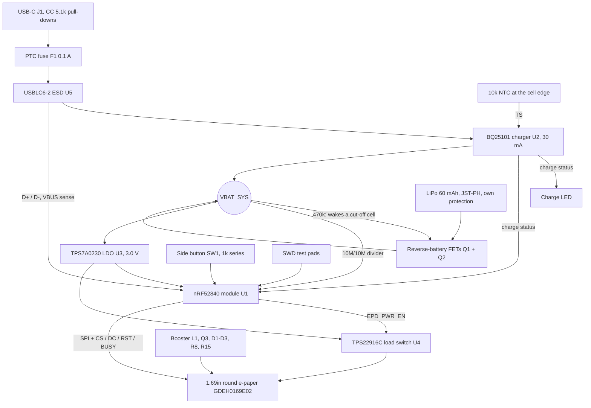

# Open E-Pin hardware

KiCad 7 project for the main board. The schematic and board are **generated** from
[`scripts/design.py`](scripts/design.py), which lists every part and every connection.
Change the design there, then regenerate, so the schematic and board never drift apart.


## Files

| Path | What it is |
|---|---|
| `kicad/open-e-pin.kicad_sch` | Schematic (one sheet, every pin labelled with its net) |
| `kicad/open-e-pin.kicad_pcb` | Board: 56 mm round with a flat for the display ribbon, 2 case-screw holes (4.6 mm, unplated, for the bezel's screw bosses), 2 notches for the case's snap hooks, 3 fiducials, 4 layers (0.8 mm), placed and routed |
| `kicad/open-e-pin.kicad_pro` | Project, including the net classes and board rules the board is routed to (written by `route.py prep`), so KiCad's DRC checks the real rules |
| `kicad/open-e-pin.kicad_sym` | Custom symbols (BQ25101, TPS7A0230, TPS22916C, GDEH0169E02 FPC) |
| `kicad/OpenEPin.pretty` | Custom footprints for TI's YFP packages (BQ25101, TPS22916C), written by `scripts/gen_footprints.py` |
| `case/` | Printed case, fit check and fastener list, see [case/README.md](case/README.md) |
| `bom/open-e-pin-bom.csv` | Bill of materials: manufacturer part numbers for every part, plus the battery, display, case parts, fasteners, pin hardware and consumables |
| `fab/` | Fabrication and assembly outputs (Gerber X2, drill, IPC-D-356 netlist, pick-and-place, fab notes), written by `scripts/gen_fab.sh` |
| `docs/audit/` | v0.1 design and manufacturing audit, and the status of each finding |
| `docs/schematic.pdf` | Schematic as a PDF |
| `docs/placement-back.png`, `docs/placement.csv` | Part placement view and coordinates |
| `docs/routing.png` | Back and front copper |
| `scripts/` | `design.py` (parts and nets), `gen_footprints.py`, `gen_schematic.py`, `gen_board.py`, `route.py`, `gen_bom.py`, `export_envelope.py` (part sizes for the case) |

## Regenerating

Needs KiCad 7 and its Python module (`pcbnew`). On Linux the system `python3` has it; on
Windows use the Python that ships with KiCad (`C:\Program Files\KiCad\7.0\bin\python.exe`)
and set `KICAD7_SYMBOL_DIR` and `KICAD7_FOOTPRINT_DIR` to KiCad's `share\kicad\symbols` and
`share\kicad\footprints` folders.

```
cd hardware/scripts
python3 design.py          # checks parts and nets
python3 gen_footprints.py  # writes kicad/OpenEPin.pretty
python3 gen_schematic.py   # writes kicad/open-e-pin.kicad_sch and the symbol library
python3 gen_board.py       # writes kicad/open-e-pin.kicad_pcb (overwrites placement!)
python3 gen_bom.py         # writes bom/open-e-pin-bom.csv
```

After routing (below), `./gen_fab.sh` writes the fabrication files to `fab/`.

### Routing

`gen_board.py` writes an unrouted board, so routing is redone after it. Needs Java 17 or later
and [Freerouting 1.9.0](https://github.com/freerouting/freerouting/releases/tag/v1.9.0)
(2.x ignores its pass limit when run from the command line and never saves).

```
python3 route.py prep      # rules, net classes, planes, GND/3V0 via fan-out; writes build/open-e-pin.dsn
java -jar freerouting-1.9.0.jar -de ../build/open-e-pin.dsn -do ../build/open-e-pin.ses -mp 100
python3 route.py import ../build/open-e-pin.ses
```

On a Linux machine with no screen, put `xvfb-run -a` in front of the `java` command.
`import` loads the autorouted tracks, fans out any GND/3V0 pad the autorouter boxed in
(ripping up the signal tracks round it if it has to),
rips up and re-routes any net that is still open or breaks clearance (a small maze router in
`route.py`), then adds GND pours on both outer layers and stitches them to the GND plane.

Stackup: B.Cu parts and signals, In1.Cu solid GND, In2.Cu 3V0 plane, F.Cu signals and GND
pour under the display. Rules (net classes in `kicad/open-e-pin.kicad_pro`): 0.15 mm tracks and
clearance, 0.2 mm for power (narrow enough to leave the 0.4 mm-pitch TI WCSP balls, and
`EPD_VDD` is in this class), 0.3 mm for the display booster, and 0.2 mm tracks with 0.2 mm
spacing for every panel rail (`PanelHV`: VGH, VGL, VSH1-3, VSL1-3, VCOM, VREFR, VREFL, VDDL).
Vias are 0.5/0.25 mm; no via is placed in or touching an SMD land (the DSN sets
`via_at_smd off`, and `route.py` removes and re-routes any it finds). The antenna keep-out is
clear of copper on every layer.

Once you start editing the routing by hand in KiCad, stop running `gen_board.py` and
`route.py` on it, and use **Tools > Update PCB from Schematic** instead.

## Block diagram



## Safety features

- Charge current set to 30 mA (0.5C for a 60 mAh cell) by R1 (4.53k, 27.6 to 32 mA over the
  charger's tolerance). The CM Batteries 55 mAh option allows 28 mA at most: fit R1 = 5.62k (about 24 mA).
- The charger (JEITA profile) pauses below 0 °C, charges to 4.06 V instead of 4.20 V between
  45 and 60 °C, and stops above 60 °C. The NTC (RT1) sits at the edge of the cell with a thermal
  pad to the pouch. **Check the cell's datasheet:** if it does not allow charging above 45 °C
  (most small pouch cells give 0 to 45 °C), the cell is outside its rating in that band; see the
  open items.
- The BQ25101 itself withstands 30 V and stops charging above about 6.7 V, but the same VBUS
  net also feeds the nRF52840's VBUS pin (5.8 V absolute maximum) and the USB ESD array (U5),
  so the board as a whole is rated for USB voltages (5.5 V max), not 30 V. A 0.1 A resettable
  fuse and the ESD array protect the USB port.
- Reverse-battery protection (Q1, Q2) blocks a backwards cell, including when USB is plugged in.
- R16 (470k, VBAT_SYS to Q2's gate) turns Q1 on from the charger, so a cell whose own
  protection has cut off after a deep discharge still sees the charger and can recover. With a
  reversed cell Q2's gate stays at least 2.3 V below its source, so the protection still holds.
- The cell's own protection circuit covers over-discharge, overcharge and short circuit; the
  board has no separate fuse on the battery, so use a cell with a protection circuit and
  IEC 62133-2 / UN 38.3 reports only.
- Standby drain from the board is about 1.1 µA besides the nRF52840 (R2/R3 divider 0.21 µA,
  R4 0.42 µA, LDO 25 nA, charger 75 nA, load switch leakage), about 3 µA in all.

## MCU pin map

| Signal | nRF52840 | Module pin |
|---|---|---|
| EPD_SCK / EPD_MOSI | P0.22 / P0.24 | 46 / 48 |
| EPD_CS / EPD_DC | P0.20 / P0.17 | 44 / 41 |
| EPD_RST / EPD_BUSY | P0.15 / P0.13 | 39 / 37 |
| EPD_PWR_EN | P1.00 | 47 |
| VBAT_SENSE (AIN5) | P0.29 | 10 |
| CHG_SENSE | P0.31 | 12 |
| BUTTON (active low, through R17 1k) | P1.06 | 57 |
| USB D+ / D- | USB | 35 / 34 |
| SWDIO / SWDCLK / RESET | SWD, P0.18 | 51 / 53 / 40 |

## Open items before ordering boards

The v0.1 audit and the status of every finding are in [docs/audit/](docs/audit/).

1. **Display FPC orientation (fixed in v0.2, confirm on a panel):** v0.1 wired J3 mirror-image.
   The panel's pin 1 is on the left in its front view (tail down), the tail folds 180 degrees
   round the board's flat edge into a bottom-contact Hirose FH12-32S-0.5SH(55) on the back, and
   the fold keeps each finger's x position, so panel pin n lands on J3 pad 33 - n
   (`design.fpc()`; `gen_board.py` refuses to write a mirrored board). Before ordering, fold a real
   panel's tail over a printout of the board and check that pin 1 (VREFR) meets the pad marked
   EPD_VREFR, at the left end seen from the front.
2. **Display wiring:** all 32 pins follow figures 7-1 and 7-2 of the GDEH0169E02
   specification (IST7601 / JD7601 controller). Panel VDD (pin 15) runs from the switched 3.0 V
   rail. The rail capacitors (C11 to C24) are 1 uF 50 V X7R 0603 (the spec asks for 0603 25 V;
   50 V keeps their capacitance at the 15 to 20 V rails). Pins 7 and 25 to 32 are left open as
   the reference shows. BS0 is pulled low for 4-wire SPI. The spec still lists refresh current as
   TBD; measure it on the first build.
3. **TI WCSP parts:** BQ25101 (YFP0006) and TPS22916C (YFP0004) are 0.4 mm-pitch WCSP with
   NSMD lands (0.23 mm copper, 0.30 mm mask, 0.25 mm paste). They need an assembler that does
   0.4 mm pitch (JLCPCB Standard PCBA, not Economic) and a 0.08 mm stencil; see `fab/README.md`.
4. **Battery:** get the cell's datasheet, UN 38.3 and IEC 62133-2 reports, lead polarity
   (J2 pin 1 = + = red) and measured thickness before ordering (the case allows 5.0 mm). If its
   charge temperature limit is 45 °C, either accept the JEITA 4.06 V band up to 60 °C or move the
   hot cut-off down with a TS resistor network.
5. **Booster:** the loop is now placed tight (C24 and C10 at L1, R15 at Q3); L1 (NRH3010, about
   0.25 A saturation) is the part the panel reference names, but the IST7601's current limit is
   not published, so check L1's current on the first build with a current probe.
6. **Antenna:** the display glass reaches about 1 mm into the module's antenna keep-out (no
   copper there on any layer). Do a range test with the panel and case fitted.
7. **DRC:** with the project's rules, DRC reports only the 4 hole-clearance items inside KiCad's
   own GCT USB4105 footprint (its plastic pegs sit 0.19 mm from two pads, as in GCT's
   recommended layout) and cosmetic silkscreen items.

## Display references

- [GDEH0169E02 product page](https://www.good-display.com/product/874.html): 1.69" round, 400 x 400, Spectra 6, 43 x 43 mm active area, 52.8 x 49.6 x 0.85 mm outline, 0 to 50 °C
- [GDEH0169E02 specification download](https://www.good-display.com/companyfile/2145.html)
- [ESP32 sample code download](https://www.good-display.com/companyfile/2147.html), for porting the driver
- [Buy: GDEH0169E02 at buy-lcd](https://buy-lcd.com/products/gdeh0169e02?VariantsId=11312)
