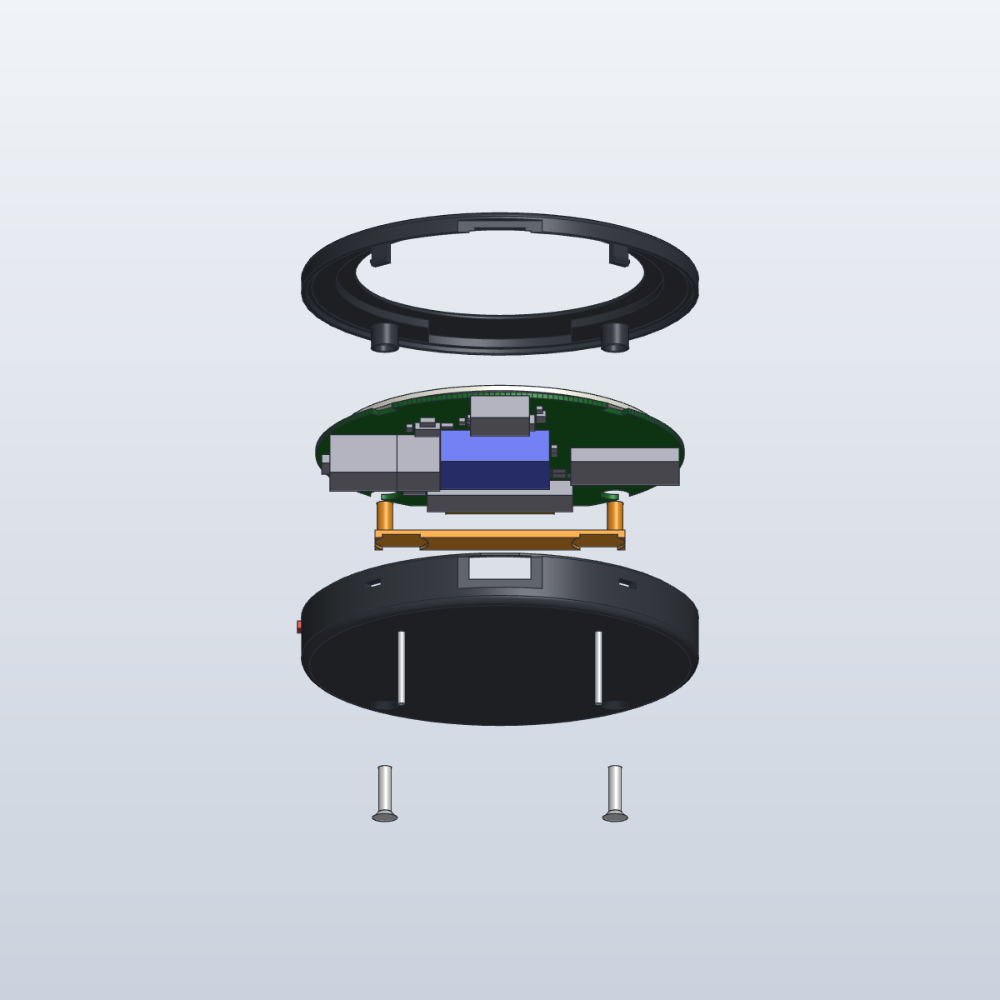
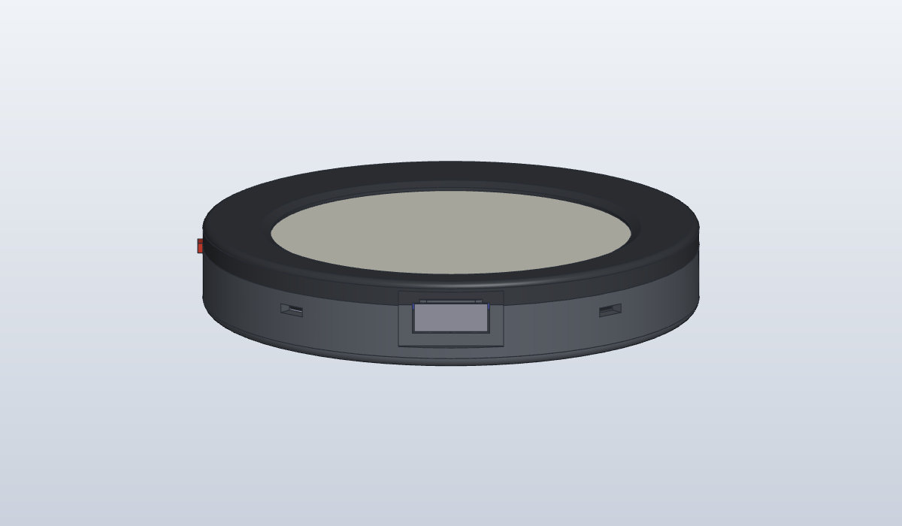
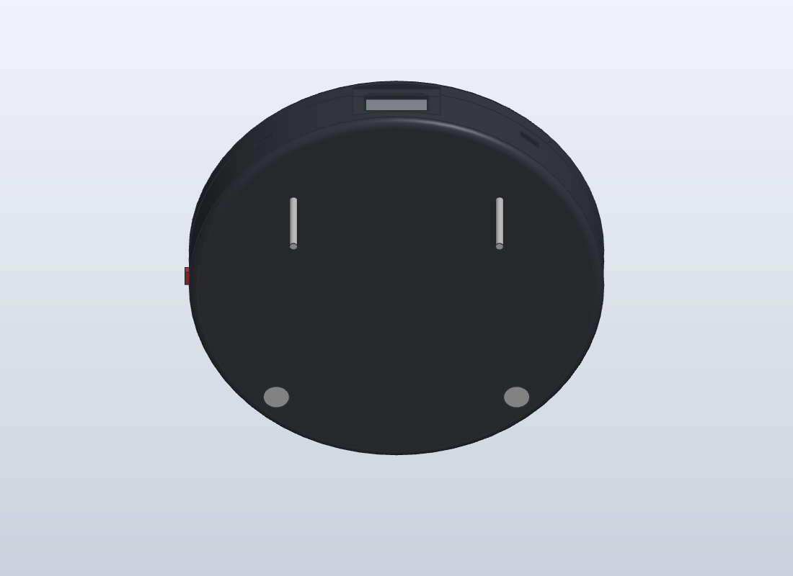
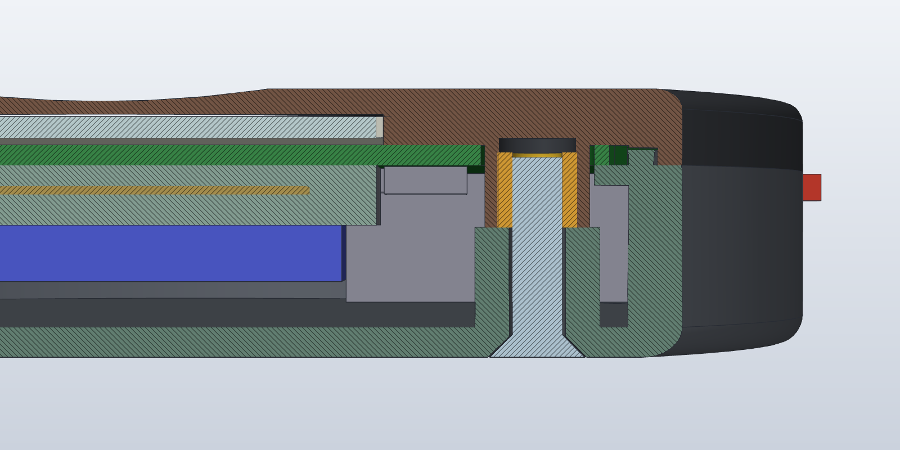
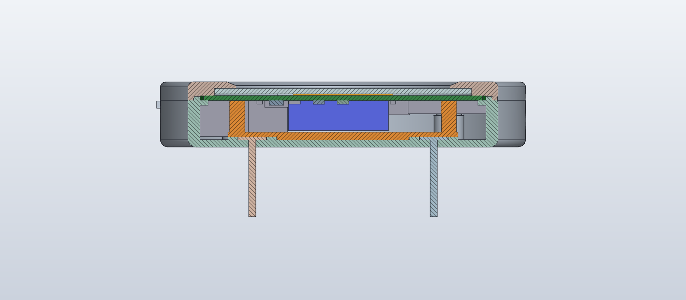

# Open E-Pin case

A two-part printed case for the 56 mm board: a **bezel** (front, display window) and a
**back cover**, held by two M2 screws at the bottom and two snap hooks at the top, plus a
small printed **button** plunger and a printed **pin retainer** that holds the two pin-back posts. It is 60.4 mm across and 10.75 mm thick.

The screws go in from the **back** into brass heat-set inserts in the bezel, so the front face
is clean: just the bezel ring and the display.











## The SolidCraft design is the master

`solidcraft/open_e_pin_case.sc` is the one source for the case. Edit it in SolidCraft, then
export every case file from it. Nothing else generates the case any more.

- **Open and edit:** open `solidcraft/open_e_pin_case.sc` in the SolidCraft app. The main sizes
  are design parameters (see `solidcraft/README.md`); change them in the Parameters panel, or
  edit features in the timeline. From the command line, `solidcraft-cli run my_edit.json --in
  open_e_pin_case.sc --save open_e_pin_case.sc` applies a command script to the design.
- **Export** (from `hardware/case/solidcraft/`):

  ```
  solidcraft-cli run export.json --in open_e_pin_case.sc --results
  ```

  `export.json` runs the interference check, then writes `../out/bezel`, `back_cover`,
  `button` and `pin_retainer` as `.step` and `.stl`, and `../out/assembly.step` with everything (case, fasteners, pin posts,
  board, parts, battery, display, ribbon). Check that the first result says `"count": 0`.
  `out/` is the only export location.
- **After a board change:** run `hardware/scripts/export_envelope.py`, then `python
  reference.py` (needs CadQuery) to rewrite `reference.step`, then replace the `Reference`
  component in the design with it (`component.delete` + `file.insert_step`) and run the
  export again.

## Files

| Path | What it is |
|---|---|
| `solidcraft/open_e_pin_case.sc` | **Master** SolidCraft design: native bodies `SC_Bezel`, `SC_BackCover`, `SC_Button`, `SC_PinRetainer`, the fasteners `SC_Screw_1/2` and `SC_Insert_1/2`, the pin posts `SC_Post_1/2`, and the imported `Reference` component |
| `solidcraft/export.json` | Command script: interference check and all exports to `out/` |
| `solidcraft/README.md` | How the design is built: features, parameters |
| `out/bezel.step`, `out/back_cover.step`, `out/button.step`, `out/pin_retainer.step` (+ `.stl`) | Printable parts, exported from SolidCraft |
| `out/assembly.step` | Everything in place, exported from SolidCraft |
| `reference.step` | Board (4.6 mm holes), parts as footprint boxes and heights, battery, JST plug, display, folded ribbon. No case parts. Imported into the design as `Reference` |
| `reference.py` | Writes `reference.step` from `board_envelope.json` (needs CadQuery) |
| `board_envelope.json` | Board outline, holes, hook notches, and each part's footprint box and height. Written by `hardware/scripts/export_envelope.py` from the KiCad board |

## Fasteners and other purchased parts

| Qty | Part | Notes |
|---|---|---|
| 2 | M2 x 8 countersunk screw, ISO 14581 (Torx T6), A2 stainless | From the back. 3.8 mm head, flush in a 90 deg countersink (4.0 mm) in the back face. DIN 965 / ISO 7046 Phillips also fits (same head) |
| 2 | M2 x 3 mm brass heat-set insert, 3.2 mm OD | Melted into the bezel bosses (3.1 mm bore, 3.6 mm deep). Another size: change `INSERT_OD` / `INSERT_HOLE` / `INSERT_DEPTH` |
| 2 | Flat-head tie tack post, 0.045 in (1.15 mm) x 1/2 in (12.7 mm), 4.7 mm flat head, for gluing. For example Otto Frei 765-14 (nickel silver) or 766-14 (yellow plated) | Fitted from the inside: the shank goes out through a 1.3 mm hole in the back plate and the head sits flush in a 4.9 mm recess on the inside, 30 mm apart and 16 mm above centre. About 11.5 mm of shank sticks out of the back. Head thickness modelled as 0.5 mm: measure it (see below) |
| 2 | Locking tie tack clutch for a 1.15 mm (0.045 in) post (spring-loaded, squeeze to release) | Must match the 1.15 mm post: clutches for thicker posts won't grip. Locking clutches don't shake off like rubber or butterfly backs |
| - | 2-part epoxy (5 to 30 minute) | Under each post head in its recess. Roughen the head first; avoid superglue, which goes brittle |
| 1 | 0.3 mm double-sided foam tape | Display to board, as a ring outside the active area |
| 1 | 1.5 mm foam pad | Between the battery and the back cover, so the cell can't rattle. Cut it to the battery's size (16 x 13 mm): the retainer bar is 1 mm past the battery's top edge |

**How the screws work.** Each bezel boss (4.2 mm, from the frame at Z = 0 down to Z = -3.3)
passes through a 4.6 mm unplated hole in the board and ends on top of a 5.0 mm boss in the
back cover. The board is clamped between the bezel frame and the back cover's ledge. The
screw goes in from the back, through a 2.3 mm clearance hole in the back-cover boss, and into
the insert in the bezel boss. Tightening pulls the two bosses together, end to end.

**Why M2.** The display glass reaches within 0.8 mm of the wall at the top, so screws only fit
at the bottom corners, beside the ribbon. There, an M2 insert (3.2 mm) fits a 4.2 mm boss that
passes through a 4.6 mm board hole, inside the keep-out round the holes. An M2.5 insert
(about 3.5 to 4 mm) would need a boss of about 5 mm or more and a board hole near 6 mm, pushing
into the parts round the holes. The M2 countersunk head is 0.9 mm deep, which fits the 1.2 mm
back plate; an M2.5 head (4.7 mm, about 1.15 mm deep) would leave almost nothing under it. The
load is a 20 g pin, so two M2 screws in brass inserts are plenty, and the inserts let the case
be opened and closed many times without wearing out plastic threads.

**Why two pin posts.** A single bar pin lets a 60 mm disc swing and flip on a moving bag, and
its catch can open. Two posts 30 mm apart can't rotate, and each needs only a small hole in the
fabric. They sit 16 mm above centre so the pin hangs upright, and so they clear the battery
connector J2 and its plug, which come down to 0.5 mm above the back plate at Y = 1 to 10.

**Why the posts are captive.** A post glued onto the outside of the case relies only on the
glue: a hard pull on the bag peels it off. Here each post goes in from the inside, so its head
sits behind 1.2 mm of back plate and can't be pulled out through the 1.3 mm hole, glue or no
glue. Epoxy holds it square and stops it turning. The printed **retainer** is a 38 x 6 x
1.2 mm bar across both posts. Its two pockets fit over 8 mm raised pads round the recesses,
which locate it and press it flat on the head of each post. Two 2.5 mm stand-offs on the bar
reach to 0.1 mm from the board's back face, so once the case is closed the board stops the bar
from lifting. Even if the glue lets go, a post can't fall inward or tilt more than about
0.1 mm. No extra tools or fasteners are needed.

**Why snap hooks at the top.** There is no room for a screw boss at the top, so the bezel has
two hooks (40 deg either side of the top) that pass through notches in the board and click into
windows in the back cover wall. Arm 3.0 x 0.8 mm, 0.35 mm barb, 4.65 mm long: about 1.9 %
strain when it flexes, fine for PETG, ABS, ASA or nylon (avoid brittle resin). To open the
case, take out the two screws from the back, push a pin into each window to free the barb,
and lift the bezel.

## Fit check (last run, in SolidCraft)

Interference check of the bezel, back cover, button and pin retainer against each other and the two posts, against every body
of the reference (board, display, ribbon, 60 parts, battery, JST plug) and against the screws and
inserts (73 bodies): **no interferences**. The only overlaps are the intended ones, left out of
the check: each insert in its bezel bore (1.48 mm³ each: the 3.2 mm insert in a 3.1 mm bore),
the screws in the inserts (contact only, 0 mm³) and the ribbon in J3 (18.25 mm³).

| Measurement | Value |
|---|---|
| Thread engagement (screw tip at Z = -0.5, insert Z = -3.3 to -0.3) | 2.8 mm, 1.4 x diameter |
| Screw tip to the end of the insert bore (Z = +0.3) | 0.8 mm |
| Front skin over the insert bore (bore end to front face) | 1.95 mm |
| Countersunk head depth in the back plate | 0.9 mm of 1.2 mm; head 0.07 mm off the countersink cone (3.8 mm head in a 4.0 mm countersink) |
| Bezel boss to board hole | 0.20 mm all round (4.2 mm boss, coaxial in the 4.6 mm hole) |
| Bezel boss to back cover (clearance cut round it, Z = -0.8 to -3.3) | 0.20 mm all round |
| Screw shank to the 2.3 mm clearance hole | 0.15 mm all round |
| Insert to the board hole | 0.7 mm |
| Bezel to display glass (front) | 0.10 mm |
| Back cover to battery | 1.5 mm, filled by the foam pad |
| Floor under each post head (recess bottom to back face) | 1.2 mm (8 mm raised pad, 0.5 mm high, round each 4.9 mm recess) |
| Post head in its recess / shank in its hole | 0.10 mm / 0.075 mm all round (4.7 mm head in 4.9 mm, 1.15 mm shank in 1.3 mm) |
| Post shank past the back face | 11.5 mm (12.7 mm shank, 1.2 mm plate) |
| Retainer pocket round the raised pad | 0.15 mm all round |
| Retainer stand-off end to board back face | 0.10 mm |
| Retainer bar to battery (Y) | 0.97 mm (bar Y = 13 to 19, battery to Y = 12.03) |
| Retainer bar to J2 / JST plug (Y) | 3.15 mm |
| Retainer stand-off to nearest part (R5) | 2.0 mm |
| Back cover to JST plug | 0.5 mm |
| Button to SW1 | 0.10 mm |

## Assembly

1. Fit the two pin posts. From the inside of the back cover, push each post's shank out through
   its 1.3 mm hole so the head lies in its 4.9 mm recess. Put a little 2-part epoxy under each
   head first (roughen the heads). Press the printed retainer bar over both heads, with its
   pockets over the raised pads and the stand-offs pointing up, and let the epoxy cure with the
   cover lying face down. Wipe off any epoxy that squeezes out round the pads, so the bar sits
   flat. The bar stays in the case.
2. Melt the two inserts into the bezel bosses from the boss ends (soldering iron about 220 deg C
   for PETG), flush with the boss ends. The bore is 0.6 mm deeper than the insert to take the
   displaced plastic.
3. Put the button plunger into its opening in the back cover from the inside, flange inward.
4. Stick the display to the board with the foam ring, fold the ribbon round the board flat and
   push it into J3, then close J3's lever.
5. Lay the board, display side down, into the bezel, with the two bezel bosses through the
   board holes and the hooks through the notches.
6. Stick the battery to the foam pad in the back cover and plug it into J2.
7. Press the back cover onto the bezel until both hooks click.
8. Last, fit the two M2 x 8 screws from the back. Snug only: about 0.1 N·m.

## Assumptions to check on real parts

- **Post head thickness.** The model uses a 0.5 mm flat head (the listed size is 4.7 mm across
  only). If your heads are thicker, deepen the recess (`PIN_PAD_DEPTH`): the raised pads and
  retainer pockets follow it. Check the shank is 0.045 in (1.15 mm) and the clutches match.
- **Battery thickness.** The seller lists the 60 mAh cell as 16 x 13 x 4 mm ±0.5, but its
  part number (051215) suggests 5 mm. The case allows 5.0 mm plus 1.5 mm of foam. Measure the cell.
- **JST connector height.** J2 and the mated plug are allowed 6.0 mm. This is the tallest
  thing in the case and sets its thickness. A lower connector, or soldering the battery
  leads straight to the board, would make the case about 1 mm thinner.
- **Ribbon reach.** The reference folds the 11.6 mm tail at a 1 mm radius and has it end
  3.7 mm inside J3. Check with a real panel before printing.
- **Insert size.** The bore (3.1 mm, 3.6 mm deep) suits a common M2 x 3 x 3.2 mm insert. Check
  the maker's recommended hole for the inserts you buy.
- **Screw length.** M2 x 8 reaches 2.8 mm into the 3 mm insert and stops 0.8 mm short of the
  bore end. An M2 x 6 would engage only 0.8 mm; an M2 x 10 would hit the bore end.
- **Board holes.** The board needs 4.6 mm unplated holes for the bezel bosses (0.2 mm all round).
- **Print tolerance.** The model uses 0.15 mm round the glass, 0.2 mm round the bezel bosses and
  0.1 mm round the barb. Print a test piece first.
